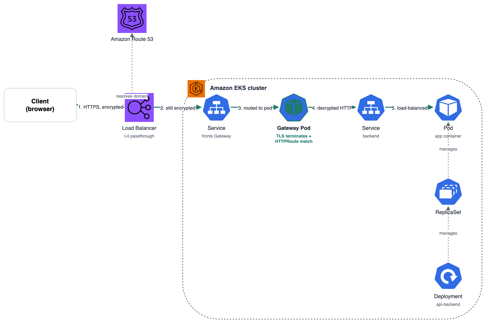
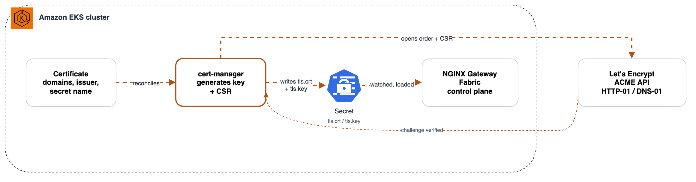

# Welcome

Welcome to my personal lab: an environment I built to put what I know as an engineer into practice. Think of it as my personal gym. At a high level, it's a website running on a Kubernetes cluster in AWS, and my goal is to build it using industry best practices and the lessons I've learned along the way.

## Lab 

The [Lab](https://github.com/RenayB/Lab) repo contains the project's Kubernetes resources (helm chart) and front end. Check it out for more details.

## Lab-Infrastructure

This repo holds the infrastructure and CI/CD that support the project, including the Terraform code and GitHub Actions pipelines that deploy its resources.

### Design 

The site runs on Amazon EKS, provisioned with Terraform. Each app is packaged as a small Helm chart, and delivery is GitOps-driven: ArgoCD watches the [Lab](https://github.com/RenayB/Lab)  repository and automatically syncs any changes to the cluster. Incoming traffic flows through a single shared Gateway, where Gateway API (implemented by NGINX Gateway Fabric) handles routing and TLS termination.

# Additional Notes 

This part of the README becomes very detailed and highlights some concpets for me to refer later on when needed. 

## Flows

## User Traffic Flow

1. The request to the website's domain resolves to its designated IP — in this case, the load balancer in front of the cluster, provisioned via the Gateway resource.
2. The load balancer receives the request and forwards the still-encrypted traffic to the Service fronting the Gateway.
3. TLS termination takes place in the Gateway's data plane pod. The handshake happens directly with the client here — key exchange, presentation and verification of the certificate, and establishment of the encrypted session.
4. NGINX now holds the decrypted HTTP request. It uses this to evaluate the matching HTTPRoute resource, which determines which backend Service — and ultimately which Deployment's pods — the request gets forwarded to.

## Certificate Flow

1. Independently of any client request — this runs ahead of time, on its own schedule — cert-manager creates a Certificate resource specifying the DNS names, which issuer to use (the Let's Encrypt endpoint), and which Secret to write the results into (private key and tls.crt).
2. cert-manager generates a private key and a CertificateRequest resource (containing the CSR built from that key).
3. cert-manager's ACME issuer talks to Let's Encrypt's ACME API. Let's Encrypt issues a challenge per domain to prove you control it — either HTTP-01 or DNS-01.
4. Once the challenge is verified, cert-manager retrieves the issued certificate from Let's Encrypt and stores the cert and key inside a Kubernetes Secret.
5. NGINX Gateway Fabric's control plane picks up that Secret and loads it into the data plane — this is the certificate that's ready and waiting when a real client's TLS handshake (step 3 of the User Traffic Flow above) happens.

## AWS Well-Architected Framework Influence

As a matter of good practice, I wanted to make sure I applied the AWS Well-Architected Framework throughout this lab. Below is how each of its six pillars shows up here.

### 1. Security

- **No long-lived AWS keys in CI/CD:** GitHub Actions authenticates through OIDC federation. 
- **Least-privilege deploy policy:** IAM actions are scoped to specific role, policy, and instance-profile ARNs. ECR and S3 access is limited to `renays-lab*` resources, and `iam:PassRole` is restricted by `iam:PassedToService`.
- **IRSA:** cert-manager gets its Route53 permissions through a role that only its own Kubernetes service account can assume, instead of borrowing the node role.
- **Private EKS API endpoint:** The control plane isn't reachable from the internet. Access goes through an SSM bastion that has no inbound ports and no SSH keys.
- **Locked-down networking:** The node security group allows no inbound traffic from the internet, only node-to-node and control-plane traffic.
- **Secure S3 defaults:** Public access is blocked, server-side encryption is on, ACLs are disabled (`BucketOwnerEnforced`), and requests that don't use TLS are denied.
- **Scanning:** Trivy scans the Terraform code before every plan, and ECR scans container images on push.
- **No secrets in git:** Sensitive values are injected from GitHub secrets at plan time.

### 2. Operational Excellence

- **Infrastructure as code:** Everything is Terraform, built from reusable modules (`vpc`, `eks-cluster`, `irsa-role`, `s3-bucket`, `ecr-repo`).
- **Isolated stacks:** Each stack (eks, bastion, dns, ecr, s3, ci-cd) has its own remote state, which limits the blast radius of a change. It also allows 
- **Safe teardown:** The destroy workflow requires typed confirmation and removes stacks in dependency order.
- **GitOps:** ArgoCD keeps the cluster in sync with the [Lab](https://github.com/RenayB/Lab) repo.

### 3. Reliability

- **Multi-AZ:** The VPC subnets span two availability zones.
- **Recoverable state:** Terraform state lives in versioned S3 buckets.
- **Managed services:** The EKS control plane, managed node groups, and Route53 take care of many failure modes.
- **Automated certificate renewal:** cert-manager renews certificates with Let's Encrypt on its own.
- **Safe replacements:** `create_before_destroy` on security groups, plus a wait-for-active step when scaling the node group.

### 4. Performance Efficiency

- **Right-sized compute:** The node instance type is based on observed memory pressure (t3.small to t3.medium).
- **One shared Gateway:** A single load balancer serves all routes, with TLS terminated at the edge.

### 5. Cost Optimization

- **Scale to zero:** The node group runs at 0–1 nodes and has a one-click scale workflow. Terraform ignores `desired_size`, so an apply never undoes a manual scale.
- **No NAT gateway:** Nodes sit in public subnets protected by security groups, which avoids NAT costs.
- **On-demand environments:** The EKS cluster and bastion can be torn down and recreated through pipelines.
- **Consistent tagging** (`project`, `environment`) for cost allocation.

### 6. Sustainability

- **Nothing idles needlessly:** Scale-to-zero and on-demand teardown mean resources run only when they're needed.
